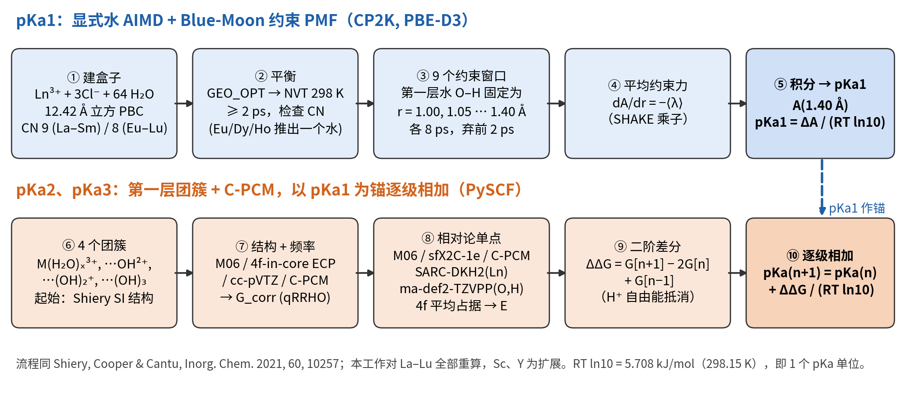
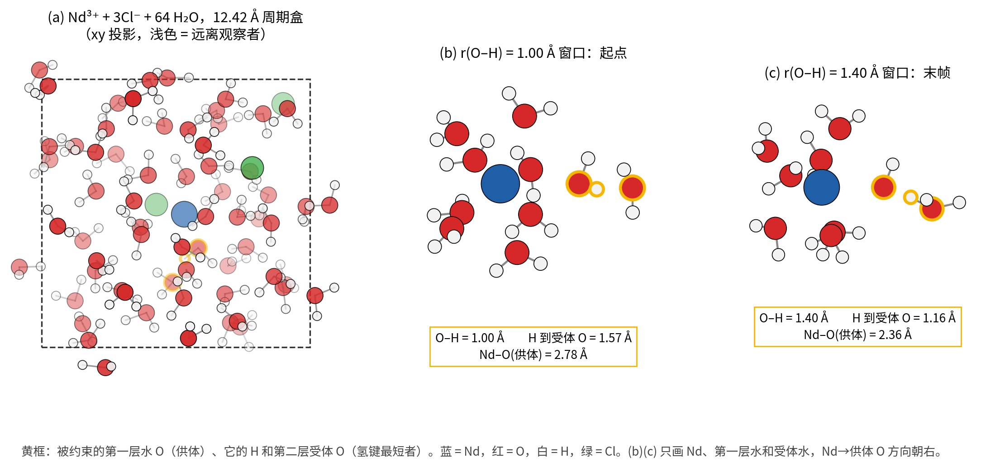
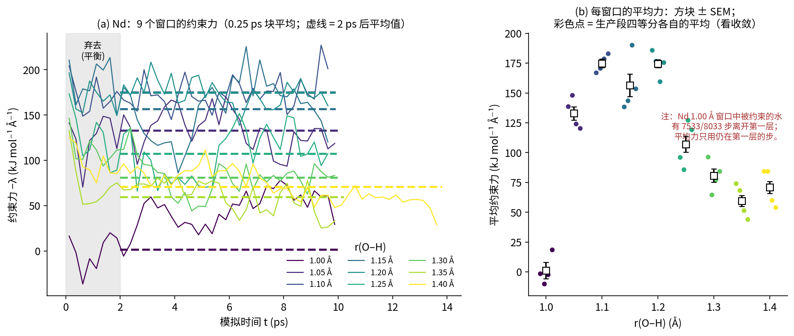
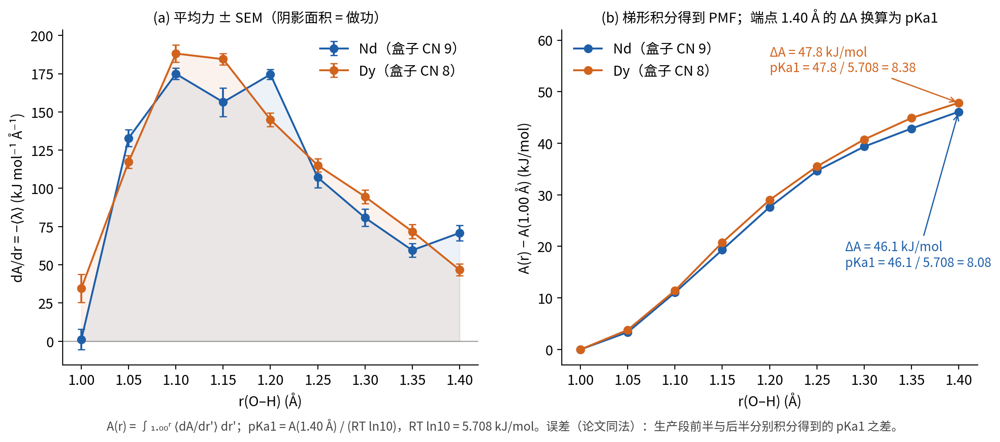
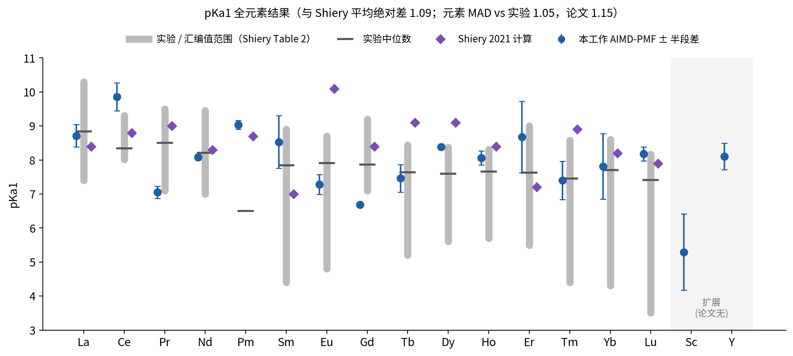
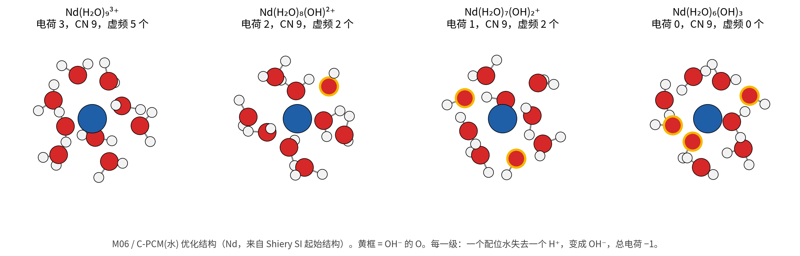
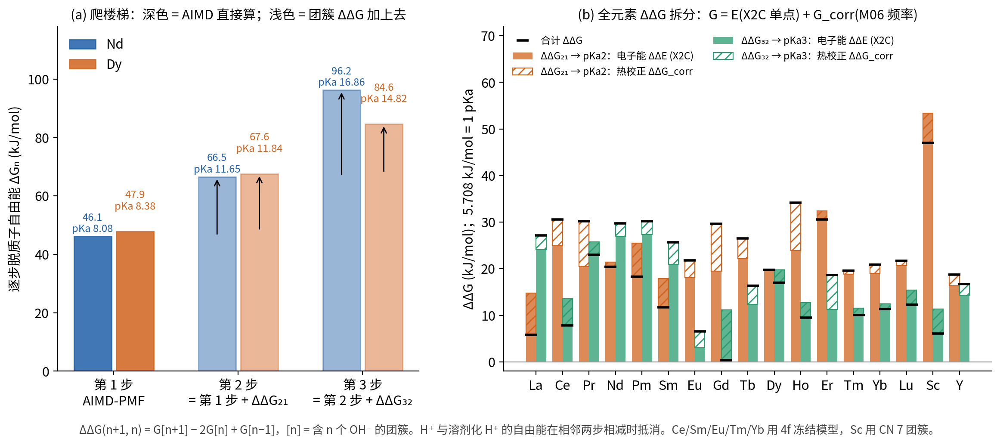
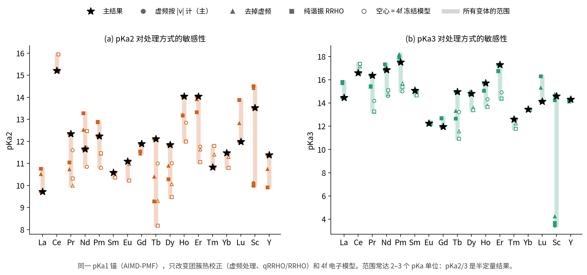
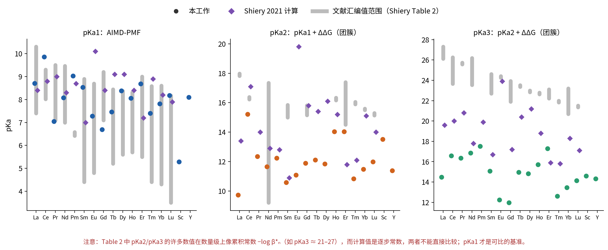

# 稀土 Ln³⁺ 逐步水解 pKa1、pKa2、pKa3 的计算方法（逐步图解）

复现并扩展 Shiery, Cooper & Cantu, *Inorg. Chem.* **2021**, 60, 10257 的方案：La–Lu 全部 15 个镧系重算，Sc、Y 为扩展（论文无）。

| 步 | 反应 | 方法 |
|---|---|---|
| pKa1 | Ln³⁺(aq) → LnOH²⁺ + H⁺ | 显式水 AIMD + Blue-Moon 约束平均力积分（PMF） |
| pKa2 | LnOH²⁺ → Ln(OH)₂⁺ + H⁺ | pKa1 + ΔΔG₂₁（第一层团簇 + C-PCM） |
| pKa3 | Ln(OH)₂⁺ → Ln(OH)₃ + H⁺ | pKa2 + ΔΔG₃₂（同上） |

换算：pKa = ΔG / (RT ln10)，298.15 K 时 **RT ln10 = 5.708 kJ/mol = 1 个 pKa 单位**。

---

## 一、pKa1：显式水 AIMD + Blue-Moon 约束 PMF

**思路**：在真实的水盒子里，用“弹簧秤”把第一层水分子的一个 H 一点点拉长，测量每个长度上维持约束所需的平均力；把力沿路径积分，就是把这个质子交给第二层水所需的自由能 ΔA。

### 步骤 1：建盒子
- Ln³⁺ + 3 Cl⁻ + 64 H₂O，12.42 Å 立方周期盒（约 1 g/cm³）。
- 第一层配位数按论文：La–Sm 为 9，Eu–Lu 为 8；Sc 自发变为 CN 7，Y 为 8。

### 步骤 2：DFT 设置与平衡
- CP2K 2024.1，PBE + D3 色散，GTH-PBE 赝势。镧系用 LnPP1 赝势（4f 在价层）+ BASIS_MOLOPT_LnPP1；H/O/Cl 用 DZVP-MOLOPT-SR-GTH。
- 平面波截断：La–Gd 500 Ry，Tb–Tm 800 Ry，Yb–Lu 1000 Ry（同论文），REL_CUTOFF 50；OT 求解，EPS_SCF 1×10⁻⁵；Ln³⁺ 取 Hund 规则多重度。
- NVT，CSVR 恒温器 298 K（τ = 100 fs），步长 1 fs。实测平均温度 304–309 K，pKa 换算仍用 298.15 K。
- 冷启动 → 结构优化 → ≥ 2 ps 平衡 → 检查 CN。Eu、Dy、Ho 无约束时变为 CN 9，用移动 Ln–O 约束（k = 30 kcal mol⁻¹ Å⁻²，推到 4.6 Å）推出一个水，再无约束平衡 1 ps，得到 CN 8。

### 步骤 3：选质子、设 9 个约束窗口
- 从平衡末帧中选第一层水里**与第二层水氢键最短**的那个 O–H（供体 O → 受体 O）。
- 约束 r(O–H) = 1.00, 1.05, …, 1.40 Å，共 9 个独立窗口，都从同一平衡帧出发；每个窗口约 8 ps，弃去前 2 ps，平均 6 ps（Nd、Dy 来自第一轮复现，平均 ≥ 7.9 / ≥ 5.6 ps；论文为每窗 15 ps）。

*图 1　Nd 盒子。(b) 1.00 Å 时质子仍在供体水上；(c) 拉到 1.40 Å 时 H 到受体 O 只剩 1.16 Å，第二层形成 H₃O⁺，第一层留下 OH⁻（Nd–O 缩短到 2.36 Å）。*

### 步骤 4：每个窗口的平均约束力
- CP2K 每步输出 SHAKE 拉格朗日乘子 λ；dA/dr = −⟨λ⟩（换算到 kJ mol⁻¹ Å⁻¹）。
- 只平均“被约束的水仍在第一层（Ln–O < 3.3 Å）”的步，保证算的是第一层水的脱质子。
- 收敛检查：生产段分四段各求平均力（图 2b 彩色点）。

*图 2　(a) Nd 9 个窗口的约束力随时间（0.25 ps 块平均，含全部步）；虚线为 2 ps 后、只取供体仍在第一层的步的平均。(b) 每窗平均力 ± SEM 与四段平均。力在 1.10–1.20 Å 最大（O–H 被拉伸最难），之后随质子转移到受体而下降。Nd 1.00 Å 窗口中被约束的水大部分时间在第二层，该窗口平均力只来自约 500 步。*

### 步骤 5：积分得到 PMF 和 pKa1
- A(r) = ∫ ⟨dA/dr′⟩ dr′，从 1.00 Å 梯形积分；**pKa1 = A(1.40 Å) / (RT ln10)**，与论文相同，不另加标准态校正。
- 误差（同论文）：生产段前半与后半各自积分得到的 pKa1 之差；另给 4 段 block 标准误（`pKa1_err_blocks`）。

*图 3　Nd：ΔA = 46.1 kJ/mol → pKa1 = 8.08 ± 0.09；Dy（CN 8）：ΔA = 47.8 kJ/mol → pKa1 = 8.38 ± 0.05。*

*图 4　全元素 pKa1。与 Shiery 计算值平均绝对差 1.09；按论文定义的元素 MAD（对该元素所有实验值取平均）本工作 1.05、论文 1.15。Sm、Er、Tm、Yb、Sc 的误差 > 0.5：个别窗口平均力在 6 ps 内仍在漂移，未完全收敛。*

---

## 二、pKa2、pKa3：第一层团簇 + C-PCM，以 pKa1 为锚逐级相加

**思路**：再做两次拉质子的 AIMD 太贵。改用只含第一层的团簇，外面的水用连续介质（C-PCM）代替，只计算“下一步比上一步难多少”（ΔΔG），从 pKa1 往上加。

### 步骤 6：四个团簇
- [0] M(H₂O)ₓ³⁺，[1] M(H₂O)ₓ₋₁(OH)²⁺，[2] M(H₂O)ₓ₋₂(OH)₂⁺，[3] M(H₂O)ₓ₋₃(OH)₃：每级一个水变成 OH⁻，电荷减 1。
- 起始结构：La–Lu 用 Shiery SI 团簇；Sc、Y 由 Lu/Ho 团簇按文献 M–O 键长缩放（Sc 最终用 CN 7）。

### 步骤 7：结构优化 + 频率 → 热校正 G_corr
- PySCF：RKS-M06 / Ln 用 4f-in-core lcecp-1-TZVP + Dolg 三价 ECP（Sc、Y 用 def2-TZVPP）/ O、H 用 cc-pVTZ / C-PCM(水，ε = 80.4) / RI-JK / (99,590) 格点。
- geomeTRIC 优化，解析 Hessian；Grimme quasi-RRHO（ω₀ = 100 cm⁻¹），298.15 K、1 atm，得到 G_corr。
- 主结果把软虚频按 |ν| 当实频计；“去掉虚频”和“纯谐振 RRHO”作敏感性。

### 步骤 8：相对论全电子单点 → 电子能 E
- UKS-M06 / sfX2C-1e，Ln 用 SARC-DKH2，O、H 用 ma-def2-TZVPP，C-PCM(水)，在步骤 7 的结构上计算。
- 4f 平均占据（每个 4f 轨道每个自旋 n/7 个电子）。Ce、Sm、Eu、Tm、Yb 在 M06 下出现 4f/配体混合或电荷转移态，改用 **4f 冻结在自由离子轨道上**（全电子版的 4f-in-core）。
- 每个物种 **G = E(X2C) + G_corr(M06/4f-in-core)**。

### 步骤 9：二阶差分 ΔΔG
- 第 n 步：[n−1] → [n] + H⁺，ΔGₙ = G[n] − G[n−1] + G(H⁺)。
- 相邻两步相减：**ΔΔG(n+1, n) = G[n+1] − 2G[n] + G[n−1]**。H⁺ 的溶剂化自由能和标准态校正全部抵消，这是团簇法最可靠的部分。

### 步骤 10：逐级相加
- **pKa2 = pKa1 + ΔΔG₂₁ / 5.708**，**pKa3 = pKa2 + ΔΔG₃₂ / 5.708**。
- 例 Nd：8.08 + 20.4 / 5.708 = 11.65；11.65 + 29.7 / 5.708 = 16.86。

*图 6　(a) Nd、Dy 的逐步自由能：第 1 步来自 AIMD，第 2、3 步是团簇 ΔΔG 叠加上去的；(b) 全元素 ΔΔG 中电子能（实心）和热校正（斜线）的贡献，黑线为合计。*

### 可靠性：敏感性分析

*图 7　固定 pKa1 锚，只改热校正方式和 4f 模型，pKa2/pKa3 常变化 2–3 个单位（Sc pKa3 的大范围来自 CN 8 团簇变体）。68 个主物种中 55 个有 1–8 个虚频（最大 223i cm⁻¹），17 个结构按噪声平台判据接受。*

---

## 三、最终结果

| 步 | 本工作 vs 论文 MAD | 本工作 vs 实验 MAD | 论文 vs 实验 MAD |
|---|---|---|---|
| pKa1 | 1.09 | 1.05 | 1.15 |
| pKa2 | 2.66 | 3.86 | 2.48 |
| pKa3 | 4.14 | 8.79 | 4.72 |

**结论**
1. **pKa1**（AIMD-PMF）是基准结果，与实验的符合程度和论文相当（MAD ≈ 1）。
2. **pKa2、pKa3** 是团簇外推的半定量结果，主要误差来自虚频/热校正处理和 4f 电子模型，还会叠加 pKa1 的误差。
3. 文献汇编中 pKa2/pKa3 的许多数值（如 pKa3 ≈ 21–27）在数量级上像累积常数 −log β*ₙ，而计算值是逐步常数，与实验的 MAD 不能直接当作误差。

## 文件
- `make_figs.py`：生成全部图（图 1、2、5 需要原始轨迹和团簇结构，仅在 NERSC 上可完整运行）。
- `data/ree_pKa_summary.csv`：每元素 pKa1–3、ΔG、ΔΔG、论文值、实验范围、质量标记。
- `data/ree_cluster_species.csv`：每个团簇的优化状态、虚频、E(X2C)、G_corr。
- `data/ree_pKa_sensitivity.csv`：团簇集合 × 热校正 × pKa1 锚的全部组合。
- `data/pmf/`：每元素每窗口的平均力、SEM、四段平均、CN、温度。
